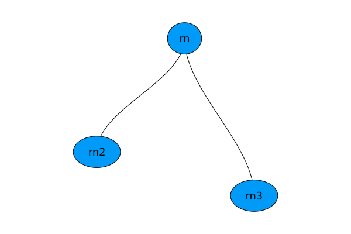
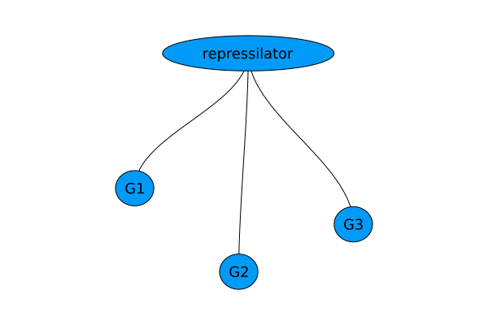

# [Compositional Modeling of Reaction Systems](@id compositional_modeling)
```@raw html
<details><summary><strong>Environment setup and package installation</strong></summary>
```
The following code sets up an environment for running the code on this page.
```julia
using Pkg
Pkg.activate(; temp = true) # Creates a temporary environment, which is deleted when the Julia session ends.
Pkg.add("Catalyst")
Pkg.add("GraphRecipes")
Pkg.add("Plots")
```
```@raw html
</details>
```
  \

Catalyst supports the construction of models in a compositional fashion, based
on ModelingToolkit's subsystem functionality. In this tutorial we'll see how we
can construct the earlier repressilator model by composing together three
identically repressed genes, and how to use compositional modeling to create
compartments.

## [A note on *completeness*](@id completeness_note)
Catalyst `ReactionSystem` can either be *complete* or *incomplete*. When created using the `@reaction_network` DSL they are *created as complete*. Here, only complete `ReactionSystem`s can be used to create the various problem types (e.g. `ODEProblem`). However, only incomplete `ReactionSystem`s can be composed using the features described below. Hence, for compositional modeling, `ReactionSystem` must be created as incomplete, and later set to complete before simulation.

To create a `ReactionSystem`s for use in compositional modeling via the DSL, simply use the `@network_component` macro instead of `@reaction_network`:
```@example ex0
using Catalyst
degradation_component = @network_component begin
  d, X --> 0
end
```
Alternatively one can just build the `ReactionSystem` via the symbolic interface.
```@example ex0
@parameters d
t = default_t()
@species X(t)
rx = Reaction(d, [X], nothing)
@named degradation_component = ReactionSystem([rx], t)
```
We can test whether a system is complete using the `ModelingToolkitBase.iscomplete` function:
```@example ex0
ModelingToolkitBase.iscomplete(degradation_component)
```
To mark a system as complete, after which it should be considered as
representing a finalized model, use the `complete` function
```@example ex0
degradation_component_complete = complete(degradation_component)
ModelingToolkitBase.iscomplete(degradation_component_complete)
```

## Compositional modeling tooling
Catalyst supports two ModelingToolkitBase interfaces for composing multiple
[`ReactionSystem`](@ref)s together into a full model. The first mechanism allows
for extending an existing system by merging in a second system via the `extend`
command
```@example ex1
using Catalyst
basern = @network_component rn1 begin
  k, A + B --> C
end
newrn = @network_component rn2 begin
  r, C --> A + B
end
@named rn = extend(newrn, basern)
```
Here we extended `basern` with `newrn` giving a system with all the
reactions. Note, if a name is not specified via `@named` or the `name` keyword
then `rn` will have the same name as `newrn`.

The second main compositional modeling tool is the use of subsystems. Suppose we
now add to `basern` two subsystems, `newrn` and `newestrn`, we get a
different result:
```@example ex1
newestrn = @network_component rn3 begin
  v, A + D --> 2D
end
@named rn = compose(basern, [newrn, newestrn])
```
Here we have created a new `ReactionSystem` that adds `newrn` and `newestrn` as
subsystems of `basern`. The variables and parameters in the sub-systems are
considered distinct from those in other systems, and so are namespaced (i.e.
prefaced) by the name of the system they come from.

We can see the subsystems of a given system by
```@example ex1
ModelingToolkitBase.get_systems(rn)
```
They naturally form a tree-like structure
```julia
using Plots, GraphRecipes
plot(TreePlot(rn), method=:tree, fontsize=12, nodeshape=:ellipse)
```


We could also have directly constructed `rn` using the same reaction as in
`basern` as
```@example ex1
t = default_t()
@parameters k
@species A(t), B(t), C(t)
rxs = [Reaction(k, [A,B], [C])]
@named rn = ReactionSystem(rxs, t; systems = [newrn, newestrn])
```

Catalyst provides several different accessors for getting information from a
single system, or all systems in the tree. To get the species, parameters, and
reactions *only* within a given system (i.e. ignoring subsystems), we can use
```@example ex1
Catalyst.get_species(rn)
```
```@example ex1
Catalyst.get_ps(rn)
```
```@example ex1
Catalyst.get_rxs(rn)
```
To see all the species, parameters and reactions in the tree we can use
```@example ex1
species(rn)   # or unknowns(rn)
```
```@example ex1
parameters(rn)
```
```@example ex1
reactions(rn)   # or equations(rn)
```
If we want to collapse `rn` down to a single system with no subsystems we can use
```@example ex1
flatrn = Catalyst.flatten(rn)
```
where
```@example ex1
ModelingToolkitBase.get_systems(flatrn)
```

More about ModelingToolkit's interface for compositional modeling can be found
in the [ModelingToolkit docs](http://docs.sciml.ai/ModelingToolkit/stable/).

## Compositional model of the repressilator
Let's apply the tooling we've just seen to create the repressilator in a more
modular fashion. We start by defining a function that creates a negatively
repressed gene, taking the repressor as input
```@example ex1
function repressed_gene(; R, name)
  @network_component $name begin
    hillr($R,α,K,n), ∅ --> m
    (δ,γ), m <--> ∅
    β, m --> m + P
    μ, P --> ∅
  end
end
nothing # hide
```
Here we assume the user will pass in the repressor species as a ModelingToolkit
variable, and specify a name for the network. We use Catalyst's interpolation
ability to substitute the value of these variables into the DSL (see
[Interpolation of Julia Variables](@ref dsl_advanced_options_symbolics_and_DSL_interpolation)). To make the repressilator we now make
three genes, and then compose them together
```@example ex1
t = default_t()
@species G3₊P(t)
@named G1 = repressed_gene(; R=ParentScope(G3₊P))
@named G2 = repressed_gene(; R=ParentScope(G1.P))
@named G3 = repressed_gene(; R=ParentScope(G2.P))
@named repressilator = ReactionSystem(t; systems=[G1,G2,G3])
```
Notice, in this system each gene is a child node in the system graph of the repressilator
```julia
plot(TreePlot(repressilator), method=:tree, fontsize=12, nodeshape=:ellipse)
```


In building the repressilator we needed to use two new features. First, we
needed to create a symbolic variable that corresponds to the protein produced by
the third gene before we created the corresponding system. We did this via
`@variables G3₊P(t)`. We also needed to set the scope where each repressor
lived. Here `ParentScope(G3₊P)`, `ParentScope(G1.P)`, and `ParentScope(G2.P)`
signal Catalyst that these variables will come from parallel systems in the tree
that have the same parent as the system being constructed (in this case the
top-level `repressilator` system).

## [Connecting components with aliases](@id compositional_modeling_aliases)
The symbols of each subsystem are namespaced, so composed components share no species or
parameters by default. Instead of building a component around the symbols of another (as with
`ParentScope` above), components can be built on their own, and then connected by *aliases*:
equations `X ~ Y` declaring that two symbols are the same. Here, a component that synthesizes a
species `X` is connected to a component that takes up a species `Y` and converts it to `Z`, with
`X` and `Y` being the same species:
```@example ex_alias
using Catalyst
synthesis = @network_component synthesis begin
    p, 0 --> X
end
uptake = @network_component uptake begin
    k, Y --> Z
    d, Z --> 0
end
@named cell = compose(synthesis, [uptake]; aliases = [uptake.Y ~ synthesis.X])
```
Aliases are written with the symbols as seen from the composed system, e.g. `synthesis.X` for
the `X` of `synthesis` and `uptake.Y` for the `Y` of its subsystem `uptake`. An alias `X ~ Y`
eliminates `X` in favor of `Y`. The aliases of a system and its subsystems are given by
[`aliases`](@ref):
```@example ex_alias
aliases(cell)
```
They are *resolved* when the system is completed, i.e. once the model is fully assembled
(completed systems can't be composed further). The eliminated symbol is then replaced by the one
it aliases throughout the model:
```@example ex_alias
cell = complete(cell)
reactions(cell)
```
The eliminated species, `uptake.Y`, is no longer one of the model's species, but remains as an
observable equal to `X`, so it can be used to give initial conditions and to read solutions:
```@example ex_alias
using OrdinaryDiffEq
u0 = [cell.uptake.Y => 0.0, cell.uptake.Z => 0.0]
ps = [cell.p => 1.0, cell.uptake.k => 2.0, cell.uptake.d => 0.5]
oprob = ODEProblem(cell, u0, 10.0, ps)
sol = solve(oprob)
sol[cell.uptake.Y] == sol[cell.X]
```
Giving different values to two names of the same symbol is an error. [`alias_map`](@ref) gives
the symbol each eliminated symbol was replaced by:
```@example ex_alias
alias_map(cell)
```

Aliases can also be declared through the `@aliases` option of the DSL (in `@reaction_network` and
`@network_component`):
```@example ex_alias
rn = @reaction_network begin
    @aliases k2 ~ k1
    k1, A --> B
    k2, B --> C
end
reactions(rn)
```
An eliminated parameter is kept as a parameter of the model, bound to the parameter that
replaced it, so it can be read (e.g. `oprob.ps[:k2]`), and its value can be given through either
name when a problem is created. Several aliases can be given in a `begin ... end` block, as for
other options. Aliases can also be given to the [`ReactionSystem`](@ref) constructor through its
`aliases` keyword argument.

### Which symbols can be aliased
Only symbols of the same kind can be aliased: species with species, boundary condition species
with boundary condition species, constant species with constant species, non-species variables
with non-species variables, and parameters with parameters. Units must match. Compound species,
observables, Brownian and Poissonian variables, and bound parameters can't be aliased. Aliases can
form chains (`X ~ Y` and `Y ~ Z` eliminate both `X` and `Y` in favor of `Z`), but not cycles.

Invalid aliases are reported when the aliases are resolved, i.e. when a network is completed (for
example, when `@reaction_network` creates it), and not when they are declared:
```@example ex_alias
try
    @reaction_network begin
        @aliases X ~ p
        p, 0 --> X
    end
catch e
    println(sprint(showerror, e))
end
```

### How reactions change
Aliasing two species of a reaction merges them, which changes its rate law: with `A ~ B`, the
reaction `2A + B --> C` becomes `3B --> C`,
```@example ex_alias
rn = @reaction_network begin
    @aliases A ~ B
    k, 2A + B --> C
end
reactions(rn)
```
whose (combinatoric) mass action rate law is that of three identical molecules, `k*B^3/6`, and
not `k*B^3/2`, which replacing `A` by `B` in the rate law of `2A + B --> C`, `k*A^2*B/2`, would
give:
```@example ex_alias
oderatelaw(reactions(rn)[1])
```
An alias that turns a reaction into one with no net change (such as `A --> B` with `A ~ B`) is an
error, as it most likely indicates a mistake:
```@example ex_alias
try
    @reaction_network begin
        @aliases A ~ B
        k1, A --> B
        k2, B --> C
    end
catch e
    println(sprint(showerror, e))
end
```
Reactions are never removed by alias elimination, so they keep their indices (e.g. for the
`physical_scales` argument of [`hybrid_model`](@ref)).

### Updating problems with `remake`
Problems created from a `ReactionSystem` accept the eliminated names in their initial conditions
and parameter values. `remake` does not translate eliminated names, and may silently ignore
them, so when updating a problem use the symbols that remain after elimination. These are given
by [`uneliminated_unknowns`](@ref) and [`uneliminated_parameters`](@ref):
```@example ex_alias
uneliminated_unknowns(cell)
```
```@example ex_alias
oprob = remake(oprob; u0 = [cell.X => 3.0])
oprob[cell.X]
```
Likewise, use the remaining symbols when creating a problem from a system made by a conversion
function (e.g. `ODEProblem(complete(ode_model(cell)), ...)`) rather than from the
`ReactionSystem` itself.

Similarly, `ModelingToolkitBase.tunable_parameters` lists both names of an aliased parameter for
the `ReactionSystem`, but only the remaining one for the systems made by the conversion functions
(and the problems made from a `ReactionSystem`), as an eliminated parameter is not an independent
parameter of the model.

### Systems with unresolved aliases
Until a system is completed, its aliases are only declarations: `@network_component`,
`compose`, `extend` and [`Catalyst.flatten`](@ref) keep them (`flatten` namespaces those of
subsystems). Basic queries, such as `species` and `parameters`, then list both names of each
aliased symbol, while [`alias_map`](@ref) is empty, as nothing has been eliminated yet. Functions that need the aliases
resolved, such as [`conservationlaws`](@ref), give an error asking to complete the system first.
Spatial models and the serialization of `ReactionSystem`s do not support aliases yet.

## Compartment-based models
Finally, let's see how we can make a compartment-based model. Let's create a
simple eukaryotic gene expression model with negative feedback by protein
dimers. Transcription and gene inhibition by the protein dimer occurs in the
nucleus, translation and dimerization occur in the cytosol, and nuclear import
and export reactions couple the two compartments. We'll include volume
parameters for the nucleus and cytosol, and assume we are working with species
having units of number of molecules. Rate constants will have their common
concentration units, i.e. if ``V`` denotes the volume of a compartment then

| Reaction Type | Example | Rate Constant Units | Effective rate constant (units of per time)
|:----------:   | :----------: | :----------:  |:------------:|
| Zero order | ``\varnothing \overset{\alpha}{\to} A`` | concentration / time | ``\alpha V`` |
| First order | ``A \overset{\beta}{\to} B`` | (time)⁻¹ | ``\beta`` |
| Second order | ``A + B \overset{\gamma}{\to} C`` | (concentration × time)⁻¹ | ``\gamma/V`` |

In our model we'll therefore add the conversions of the last column to properly
account for compartment volumes:
```@example ex1
# transcription and regulation
nuc = @network_component nuc begin
  α, G --> G + M
  (κ₊/V,κ₋), D + G <--> DG
end

# translation and dimerization
cyto = @network_component cyto begin
  β, M --> M + P
  (k₊/V,k₋), 2P <--> D
  σ, P --> 0
  μ, M --> 0
end

# export reactions,
# γ,δ=probability per time to be exported/imported
model = @network_component model begin
  γ, $(nuc.M) --> $(cyto.M)
  δ, $(cyto.D) --> $(nuc.D)
end
@named model = compose(model, [nuc, cyto])
```
A graph of the resulting network is
```julia
Graph(model)
```

